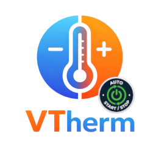

  

[![GitHub Release][releases-shield]][releases]
[![GitHub Activity][commits-shield]][commits]
[![License][license-shield]](LICENSE)
[![HACS][hacs_badge]][hacs]
[![BuyMeCoffee][buymecoffeebadge]][buymecoffee]

# 🌡️ VTherm Auto Start/Stop

**[Français](README-fr.md) · [English](README.md)** · [Contributeurs (FR)](CONTRIBUTING-fr.md) · [Contributors (EN)](CONTRIBUTING.md)

Un plugin pour [Versatile Thermostat](https://github.com/jmcollin78/versatile_thermostat)
qui arrête automatiquement votre équipement de climatisation une fois que la
pièce a atteint sa consigne, et qui laisse Versatile Thermostat le redémarrer
normalement quand la température s'éloigne à nouveau.

## 🎯 À quoi ça sert ?

Votre équipement (pompe à chaleur, chaudière, climatiseur…) continue de
**fonctionner** jusqu'à ce que la logique de Versatile Thermostat décide du
contraire — même lorsque la pièce est déjà à la consigne. Ce plugin
surveille la température et **demande l'arrêt de l'équipement quand elle est
atteinte**, puis laisse Versatile Thermostat le redémarrer normalement quand la
pièce s'écarte de la consigne.

- **Économies d'énergie** — chaque arrêt automatique évite des minutes inutiles de
  compresseur ou de chaudière.
- **Entièrement automatique** — aucun bouton à presser : c'est le plugin qui
  demande l'arrêt.
- **Vous restez maîtres** — chaque thermostat reçoit une entité *auto-start/stop
  activation*, une sélection *auto-start/stop mode d'arrêt*, une sélection
  *auto-start/stop niveau de détection* et deux entités de paramètres, directement
  dans le tableau de bord.
  La carte UI VTherm, inchangée, les pilote exactement comme avant.
- **Une seule configuration globale** couvre tous vos thermostats ; les
  paramètres par thermostat sont optionnels et ne sont jamais nécessaires juste
  pour activer une pièce.
- **Autonome** — l'auto start/stop fonctionne entièrement comme plugin, la
  logique de Versatile Thermostat restant inchangée.

## 🔍 Comment la détection fonctionne-t-elle ? (en termes simples)

Régulièrement, le plugin prend une mesure et se pose une seule question :
**« À combien près la pièce est-elle de la consigne, et depuis combien de temps ? »**

1. **L'écart** — la température actuelle est comparée à la consigne. Si la pièce
   est encore 2 °C sous la consigne, l'écart vaut 2 °C.
2. **Le score** — depuis la mesure précédente, cet écart est multiplié par le
   temps écoulé et ajouté à un **score** courant (l'*erreur accumulée*). Un écart
   qui persiste fait monter le score ; un écart qui disparaît ne le fait pas.
3. **Le verdict** — l'équipement se voit demander un arrêt lorsque le score
   dépasse un **seuil** *et* que la température, projetée avec sa tendance
   actuelle (marge de sécurité de 0,5 °C), a déjà franchi la consigne.
4. **La libération** — lorsque l'écart change de signe (la pièce repart dans
   l'autre sens), le score est divisé par deux plutôt que remis à zéro, pour que
   une petite oscillation ne relance pas toute la détection.
5. **Vos commandes priment** — un changement de preset ou de consigne remet le
   score à zéro immédiatement : vous avez explicitement demandé autre chose,
   donc une détection en instance ne peut pas maintenir la décision précédente.

La rapidité avec laquelle un arrêt est décidé est réglée par le **niveau** : un
niveau fixe la **durée minimale** (`dt_min`, le temps pendant lequel l'écart doit
persister avant tout verdict) et le **seuil de score** à dépasser.

| Niveau        | `dt_min` (minutes) | Seuil de score | Caractère                |
| ------------- | ------------------ | -------------- | ------------------------ |
| Très lent     | 60                 | 20             | Arrête rarement, tard    |
| Lent (défaut) | 30                 | 10             | Équilibré                |
| Moyen         | 15                 | 5              | Modéré                   |
| Rapide        | 7                  | 2              | Arrête vite              |
| Personnalisé  | 5 → 120            | 1 → 50         | Vous choisissez les deux |

Le niveau par défaut est **Lent (30 / 10)**, le comportement de
l'ancienne fonctionnalité du core.

> Le niveau est une **étiquette de préréglage dérivée des deux valeurs**, pas un
> réglage stocké. Deux entités par thermostat portent les paramètres :
> **auto-start/stop durée minimum avant arrêt** (5 → 120 minutes) et
> **auto-start/stop seuil** (1 → 50, pas de 0,5). Choisir un niveau nommé écrit
> les deux valeurs d'un seul geste ; écrire
> une valeur vous-même reclasse le niveau en *Personnalisé* dès qu'il ne
> correspond plus à une paire nommée. La sélection de niveau ne fait que refléter
> cette paire — elle n'en est jamais la source de vérité.

## 📋 Thermostats pris en charge

- Seuls les thermostats **`over_climate`** (un Versatile Thermostat pilotant un
  équipement clim) sont éligibles.
- **Les thermostats à régulation par vanne ne sont pas pris en charge** — la
  même restriction que la fonctionnalité du core, conservée volontairement pour
  que la migration soit une simple mainlevée.

## 📦 Installation

**Prérequis**

- Home Assistant **2026.10** ou plus récent.
- Versatile Thermostat **11.x ou une version ultérieure**, avec la prise en
  charge de la **délégation externe auto start/stop**.

**Option A — HACS**

1. Ajoutez ce dépôt comme intégration personnalisée dans HACS (via la *Marketplace*
   ou à partir de l'URL du dépôt).
2. Redémarrez Home Assistant.
3. Allez dans **Paramètres → Appareils et services** et ajoutez
   **VTherm Auto Start/Stop**.

**Option B — Manuelle**

1. Copiez le dossier `custom_components/vtherm_auto_start_stop` dans le
   répertoire `config/custom_components/` de Home Assistant.
2. Redémarrez Home Assistant.
3. Allez dans **Paramètres → Appareils et services** et ajoutez
   **VTherm Auto Start/Stop**.

## ⚙️ Configuration

### 🌍 La configuration globale (la seule obligatoire)

La première fois que vous ajoutez l'intégration, vous configurez les
**paramètres globaux** :

- **Activation initiale** et **mode d'arrêt initial** — des valeurs par défaut
  utilisées **uniquement** tant que les contrôles d'un thermostat n'ont pas
  d'état sauvegardé (un thermostat nouveau). Une fois qu'un contrôle a un état
  sauvegardé, modifier ces valeurs par défaut ne le réinitialise jamais, même
  s'il n'a jamais été touché à la main.

Le niveau de détection ne fait pas partie de ce formulaire : il est dérivé des
deux entités de paramètres. Un thermostat nouveau démarre au niveau par défaut
et, lors d'une migration, il est initialisé une fois depuis le niveau historique
du core.

Chaque thermostat éligible reçoit automatiquement son propre jeu de contrôles,
tous préfixés par **auto-start/stop** pour être regroupés et triés ensemble dans
l'interface :

- **auto-start/stop activation** (interrupteur) — active ou désactive la
  détection pour ce thermostat uniquement, sans toucher à son mode d'arrêt
  sauvegardé.
- **auto-start/stop mode d'arrêt** (sélection) — le mode HVAC appliqué quand le
  plugin demande un arrêt.
- **auto-start/stop niveau de détection** (sélection) — un *préréglage* qui lit
  le niveau dérivé des deux entités de paramètres ; choisir un niveau nommé
  écrit les deux paramètres d'un seul geste.
- **auto-start/stop durée minimum avant arrêt** et **auto-start/stop seuil**
  (entités `number`) — les deux paramètres de détection eux-mêmes, modifiables
  directement et par thermostat.

| Mode d'arrêt      | Comportement à l'arrêt automatique      | Disponibilité |
| ----------------- | --------------------------------------- | ------------- |
| Off `off`         | L'équipement est mis hors tension       | Toujours      |
| Ventilation       | L'équipement passe en ventilation       | Si supporté   |
| Déshumidification | L'équipement passe en déshumidification | Si supporté   |

> **`Off` est un mode d'arrêt, pas un moyen de désactiver la fonctionnalité.**
> Désactiver ou activer la détection est le seul rôle de l'interrupteur ;
> choisir `Off` ne dit que *comment* l'équipement est arrêté. Choisir un mode
> d'arrêt n'active ni ne désactive la détection.

Tous ces états survivent aux rechargements et redémarrages, indépendamment de
toute entrée de configuration. Écrire un paramètre ne crée jamais d'entrée de
configuration, ne modifie jamais les paramètres globaux et **ne recharge jamais
un thermostat** : le manager attaché prend la nouvelle valeur immédiatement.
Changer un paramètre laisse aussi le score accumulé intact — le score mesure un
écart observé, tandis que les paramètres sont les critères qui lui sont
appliqués.

### 🎛️ Les paramètres par thermostat (entrées dédiées optionnelles)

Les paramètres de détection sont déjà propres à chaque thermostat : chaque
thermostat couvert possède ses entités **auto-start/stop durée minimum avant
arrêt**, **auto-start/stop seuil** et **auto-start/stop niveau de détection**.
Une entrée de configuration dédiée est donc optionnelle
; elle ne change que la **couverture** et les **valeurs de semence** d'un seul
thermostat — elle n'est jamais nécessaire pour activer une pièce ni pour régler
un paramètre.

### 🗑️ Supprimer des entrées

- Supprimer une entrée **dédiée** ne retire que sa couverture et ses semences ;
  les contrôles du thermostat et leurs états sauvegardés restent intacts tant
  que l'entrée globale le couvre.
- Supprimer l'entrée **globale** retire les contrôles de tous les thermostats
  qui n'ont pas d'entrée dédiée ; ceux qui en ont conservent leurs contrôles.

## 🔄 Migration depuis la fonctionnalité du core

Si vos thermostats utilisaient déjà l'auto start/stop intégré :

- Avec les versions coordonnées du core et du plugin installées, un rechargement
  passe la main au plugin : le core efface son drapeau de fonctionnalité
  historique, supprime l'ancien interrupteur et la sélection, et le plugin
  recrée les contrôles **sous leurs anciens identifiants d'entité exacts** —
  tableaux de bord, cartes et automatisations continuent de fonctionner sans
  changement.
- Lorsqu'un thermostat devient couvert, son niveau est **initialisé depuis le
  niveau historique du core** quand celui-ci est disponible ; un état de
  paramètre restauré n'est jamais écrasé. La semence n'est lue qu'une fois,
  lorsqu'un contrôle n'a pas d'état sauvegardé.
- Supprimer le plugin ne **réactive pas silencieusement** l'ancienne
  fonctionnalité du core — réactivez-la via Versatile Thermostat si vous la
  voulez de retour.

## ❓ Questions fréquentes

**J'ai désactivé la fonctionnalité sur un thermostat — pourquoi les contrôles
et les attributs s'affichent-ils encore ?**
Désactiver est un état sauvegardé, pas une désinstallation : le thermostat
conserve son score (gelé), son mode d'arrêt, son niveau et ses deux paramètres,
de sorte que la réactivation est immédiate. En mode désactivé, la détection
n'accumule plus et ne demande aucun arrêt.

**Pourquoi mes valeurs personnalisées ont-elles disparu quand j'ai choisi un
niveau nommé ?**
Un niveau nommé est un préréglage : le choisir écrit les deux paramètres sur la
paire de ce niveau. Revenir à *Personnalisé* ne restaure pas les valeurs
précédentes — il n'en existe aucune copie cachée. Réglez à nouveau les deux
entités `number` pour retrouver vos valeurs.

**J'ai changé le mode d'arrêt dans l'entrée de configuration — pourquoi le
thermostat n'a-t-il pas bougé ?**
L'entrée ne fournit qu'une **semence**, lue quand un contrôle n'a pas
d'état sauvegardé. Un thermostat couvert conserve ses propres entités de
contrôles ; modifiez la sélection **auto-start/stop mode d'arrêt** de ce
thermostat (ou appelez les `number` par service) pour changer un thermostat en
service.

**Puis-je activer la fonctionnalité pour un seul thermostat ?**
Oui — configurez les paramètres globaux avec *activation initiale* désactivée,
puis basculez l'interrupteur uniquement sur le ou les thermostats souhaités.
Aucune entrée de configuration supplémentaire n'est créée.

**Mon thermostat régulé par vanne n'est pas proposé dans le sélecteur.**
C'est intentionnel : les thermostats `over_climate` régulés par vanne restent
exclus, exactement comme avec la fonctionnalité du core.

## 🤝 Contribuer

Voir [CONTRIBUTING-fr.md](CONTRIBUTING-fr.md) / [CONTRIBUTING.md](CONTRIBUTING.md)
pour la conception, le workflow OpenSpec obligatoire et les interactions avec le
core de Versatile Thermostat.

> **Note :** ce plugin remplace la fonctionnalité auto start/stop équivalente du
> core de Versatile Thermostat, qui sera **complètement supprimée en 2027**.

[commits]: https://github.com/jmcollin78/vtherm_auto_start_stop/commits/main
[commits-shield]: https://img.shields.io/github/commit-activity/m/jmcollin78/vtherm_auto_start_stop.svg?style=flat-square
[releases]: https://github.com/jmcollin78/vtherm_auto_start_stop/releases
[releases-shield]: https://img.shields.io/github/release/jmcollin78/vtherm_auto_start_stop.svg?style=flat-square
[license-shield]: https://img.shields.io/github/license/jmcollin78/vtherm_auto_start_stop.svg?style=flat-square
[hacs]: https://hacs.xyz/
[hacs_badge]: https://img.shields.io/badge/HACS-Default-orange.svg?style=flat-square
[buymecoffee]: https://www.buymeacoffee.com/jmcollin78
[buymecoffeebadge]: https://img.shields.io/badge/Buy%20Me%20A%20Coffee-FFDD00?style=flat-square&logo=buy-me-a-coffee&logoColor=black
